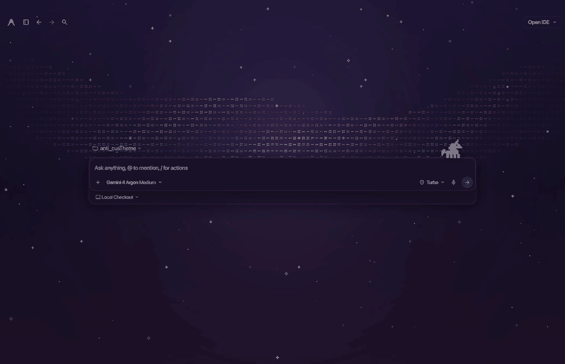
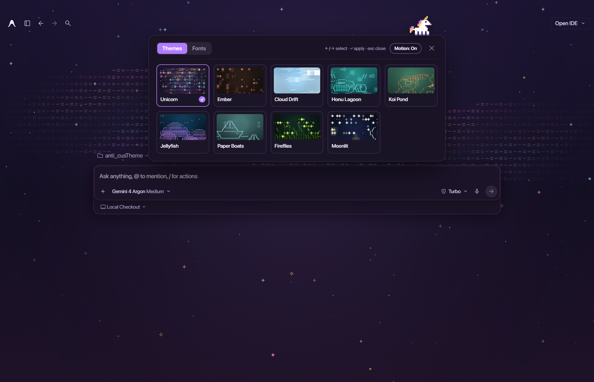
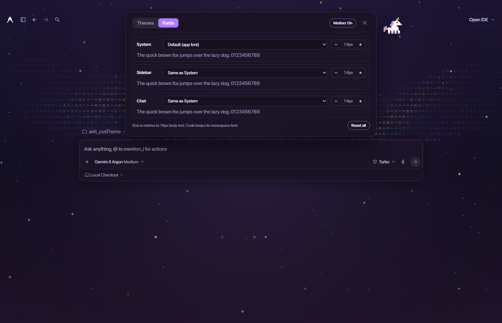

# anti_cusTheme


**Live ASCII wallpapers, a pixel unicorn and custom fonts for the Google Antigravity desktop app.**



> **Unofficial.** Not affiliated with or endorsed by Google. It only restyles the local app window:
> no access to your account, the API or your conversations. Read [Safety](#safety) first.
> Tested with Antigravity desktop **2.28.2** on Windows 11.

## Install

```powershell
git clone https://github.com/C0xff/anti_cusTheme.git
cd anti_cusTheme
.\patch.bat
```

`patch.bat` closes Antigravity, installs the theme and reopens it. Click the unicorn on the chat box
to pick a wallpaper or change fonts.

To remove it, run `.\unpatch.bat`. The original app file is restored byte for byte.

## Features

- **9 live ASCII wallpapers** behind the chat, each recoloring the whole UI: Unicorn, Ember,
  Cloud Drift, Honu Lagoon, Koi Pond, Jellyfish, Paper Boats, Fireflies, Moonlit.
- **Pixel unicorn mascot** sitting on the chat box. Click it to open the panel.
- **Custom fonts** from the fonts installed on your machine, set separately for the **System**,
  the **Sidebar** and the **Chat**, each with its own text size. Code blocks keep their monospace font.
- **Motion On/Off**: one click stops every animation to save GPU and battery.
- **Survives app updates**: re-applies itself at the next Windows login, or just run `patch.bat` again.
- **No dependencies**: Python standard library only.

| Themes | Fonts |
| --- | --- |
|  |  |

## Usage

| Task | How |
| --- | --- |
| Open the panel | Click the unicorn, type `/theme` or `/font` in the chat box then Enter, or press `Ctrl+Shift+T` / `Alt+T` |
| Change wallpaper | Panel → Themes. Arrow keys preview, Enter applies, Esc closes |
| Change fonts and sizes | Panel → Fonts |
| Stop animations | Panel header → **Motion: On/Off** |
| Re-apply after an Antigravity update | `patch.bat` |
| Remove | `unpatch.bat` |

Advanced: `py cli.py status` shows the app version, patch state and backup. Run `py cli.py --help`
for the other commands.

## What It Changes

| Location | Change |
| --- | --- |
| `%LOCALAPPDATA%\Programs\antigravity\resources\app.asar` | A ~1 KB loader is appended to the app's main script |
| `~/.gemini/anti-custheme/` | Theme bundle, a backup of the original `app.asar`, patch state, log |
| `%APPDATA%\Microsoft\Windows\Start Menu\Programs\Startup\anti-custheme-autoheal.vbs` | Re-applies the theme at login after an app update (hidden, never closes a running app) |

Nothing is sent over the network. Your theme, motion and font choices are stored in the app's own
`localStorage`.

## Safety

- The theme patches the app's code archive. A future Antigravity version may change its internals
  or start verifying that archive. The theme may then stop working, or the app may refuse to start
  until you run `unpatch.bat` or reinstall Antigravity.
- Reinstalling Antigravity always fully restores the original app.
- The theme never calls Antigravity's services, never reads credentials and sends nothing over the
  network. Modifying the app may still not be permitted by its terms of use. Use at your own risk.

## Requirements

- Windows 10/11 with the Antigravity 2.x desktop app in `%LOCALAPPDATA%\Programs\antigravity`
- Python 3.10+ (`py` launcher)

The Antigravity IDE (VS Code based editor), macOS and Linux are not supported.

## Contributing

Issues and pull requests are welcome, especially new wallpaper ideas. Please run `py cli.py test`
before opening a PR (needs Node.js 22+ and Chrome or Edge) and say which Antigravity version you
tested on (`py cli.py status`).

Please report security problems privately through GitHub Security Advisories rather than in a
public issue.

## License

[MIT](LICENSE) © C0xff. Antigravity is a trademark of Google LLC.
